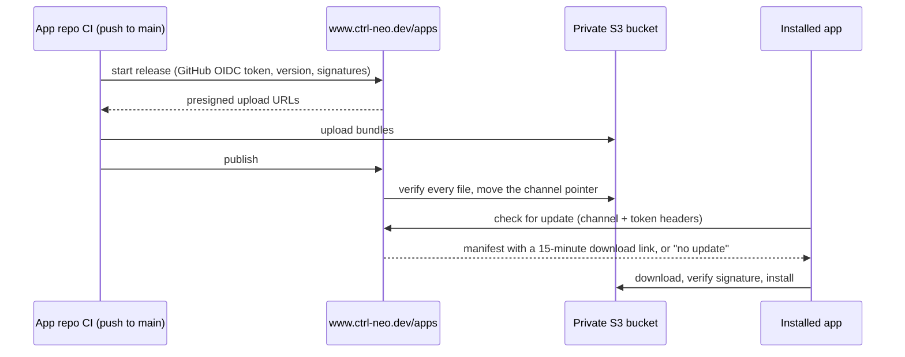

# Apps release service: versioning, channels and publishing

The studio's release service lives in this repo as the Nuxt layer `layers/apps/` and serves every app under
`https://www.ctrl-neo.dev/apps/…`. It stores releases in the studio's private S3 bucket, decides who may see which
channel, and hands out short-lived download links. Apps never talk to S3 directly, and CI never holds storage keys.

This guide covers how versions and channels work, how to give people access to restricted channels, how to onboard a
new app, and how to reuse the service (or the whole layer) from another Nuxt project. For the app-side setup of a
Tauri app (updater plugin, update UI), see `docs/tauri-updater-guide.md` in the
[neomap-editor](https://github.com/CTRL-Neo-Studios/neomap-editor) repo.

> Always use `https://www.ctrl-neo.dev`. The bare `ctrl-neo.dev` redirects to `www`, and an updater following a
> cross-host redirect drops request headers, so restricted channels would fail.

## How a release flows



## Versions

Versions are **strict semver**, the only form the Tauri updater and bundler accept.

| You write | Valid | Notes |
|---|---|---|
| `0.1.0`, `1.4.2` | yes | normal releases |
| `1.0.0-beta.1`, `1.0.0-insider.3` | yes | prereleases |
| `1.0.0.alpha1`, `v1.0`, `1.0` | no | rejected by Tauri and by the service |
| `1.0.0-alpha10` | technically | **avoid**: `alpha10` sorts *before* `alpha9` (text comparison) |
| `1.0.0-alpha.10` | yes | sorts after `alpha.9` (numeric comparison). Always put a dot before the number |

Ordering follows semver: `1.0.0-alpha.1 < 1.0.0-beta.1 < 1.0.0-rc.1 < 1.0.0 < 1.0.1`. A prerelease sorts **before**
its plain version, so `1.0.0-beta.1` is older than `1.0.0`.

**One rule for every app: a release is a version bump.** CI builds on every push to `main`, but it only publishes when
the version is new. Pushing again with the same version builds and then skips the publish with a notice.

The service enforces:

- **A version can never be replaced.** Once `1.2.0` is published, publishing `1.2.0` again is rejected. To fix a broken
  release, ship `1.2.1`.
- **A version must be newer than its channel's current release.** Downgrades are impossible, and installed apps never
  move to a lower version either.

> Windows MSI installers can't carry prerelease versions (the bundler requires the prerelease part to be a plain number
> ≤ 65535). The shared workflow only builds NSIS on Windows, so this only matters if an app turns MSI back on.

## Channels

A **channel** is a stream of releases: `stable`, `beta`, `insider`, `team`, or anything you define. Each app declares
its channels in `layers/apps/server/utils/apps.ts`:

```ts
'neomap-editor': {
	repo: 'CTRL-Neo-Studios/neomap-editor',
	channels: {
		stable: {access: 'public'},
		beta: {access: 'public', includes: ['stable']},
		insider: {access: 'restricted', includes: ['beta', 'stable']},
		team: {access: 'restricted', includes: ['insider', 'beta', 'stable']}
	}
}
```

- **`access: 'public'`**: anyone can read it.
- **`access: 'restricted'`**: needs an access token with a grant for that channel (see [Access](#access-to-restricted-channels)).
- **`includes`**: other channels this one also offers. The newest version among them wins, so a beta user moves up to
  stable once stable overtakes beta. Without `includes`, a channel only ever offers its own releases.

### Which channel a release goes to

By default, the **prerelease tag picks the channel**:

| Version | Channel |
|---|---|
| `1.2.0` | `stable` |
| `1.3.0-beta.1` | `beta` |
| `1.3.0-insider.4` | `insider` |
| `1.3.0-rc.1` | `rc`, which must exist in the app's channels or the publish is rejected |

To override, pass `channel:` to the shared workflow (see [onboarding](#onboarding-a-new-tauri-app)). Prefer naming the
prerelease after the channel; it keeps the version self-explanatory.

### Adding a channel

Add one line to the app's `channels` in `apps.ts` and deploy prism. Example, a public `nightly` that also offers beta
and stable:

```ts
nightly: {access: 'public', includes: ['beta', 'stable']},
```

Then publish versions like `1.4.0-nightly.12`.

### Typical layouts

| Need | Channels |
|---|---|
| Just releases | `stable` |
| Public testing | `stable`, `beta` (+ `includes: ['stable']`) |
| Private testers | add `insider: {access: 'restricted', includes: ['beta', 'stable']}` |
| Studio-only builds | add `team: {access: 'restricted', includes: ['insider', 'beta', 'stable']}` |

## Access to restricted channels

Users and their grants live in `apps/_access.json` in the bucket, and only token **hashes** are stored there. Manage it
with the CLI from the prism repo. It reads `NUXT_APPS_S3_*` from `.env` (copy `.env.example`, or `vercel env pull`).

```bash
bun run apps:access add alice --grant neomap-editor:insider --note "QA"   # prints alice's token once
bun run apps:access grant alice '*:beta'                                  # grants: app:channel, * = any
bun run apps:access revoke alice neomap-editor:insider
bun run apps:access rotate alice                                          # new token; old one stops working
bun run apps:access remove alice
bun run apps:access list
```

- **Grants** are `app:channel`. `*` matches any app or any channel: `neomap-editor:*`, `*:insider`, `*:*` for the team.
- **Tokens** look like `neo_…` and are shown exactly once. The user pastes theirs into the app's update settings.
- **Changes reach the live site within 30 seconds.** Revoking someone takes effect on their next check after that.
- If two people edit at the same moment, the CLI may say *"someone else kept editing the access file"*. Run the command
  again; nothing was lost.

What happens on a check:

| Situation | Response |
|---|---|
| public channel | update, or "no update" (204) |
| restricted, no token or unknown token | 401 |
| token without a grant for this app and channel | 403 |
| unknown app or channel | 404 |

## Onboarding a new Tauri app

Do these in order; the app-side steps are detailed in the neomap-editor guide.

1. **Register the app** in `layers/apps/server/utils/apps.ts`:
   ```ts
   'my-app': {
   	repo: 'CTRL-Neo-Studios/my-app',   // the only repo allowed to publish it
   	channels: {stable: {access: 'public'}, beta: {access: 'public', includes: ['stable']}}
   },
   ```
   The slug (`my-app`) is lowercase letters, digits and dashes. It appears in every URL and storage path, so pick it
   once. Deploy prism.
2. **Set up the app** (updater plugin, signing key, public key, endpoint
   `https://www.ctrl-neo.dev/apps/updates/my-app/{{target}}/{{arch}}/{{current_version}}`).
3. **Add the signing secrets** to the app repo: `TAURI_SIGNING_PRIVATE_KEY`, `TAURI_SIGNING_PRIVATE_KEY_PASSWORD`.
4. **Call the shared workflow** from the app repo, `.github/workflows/release.yml`:
   ```yaml
   name: Release
   on:
     push:
       branches: [main]
     workflow_dispatch:
   jobs:
     release:
       uses: CTRL-Neo-Studios/prism/.github/workflows/tauri-release.yml@main
       with:
         app: my-app
         # optional: channel: beta    (default: from the prerelease tag)
         # optional: notes: "…"       (default: the head commit message)
       secrets: inherit
       permissions:
         contents: read
         id-token: write
   ```
5. **Bump the version and push to `main`.**

### What the shared workflow does

`.github/workflows/tauri-release.yml` (this repo):

| Platform | Built as | Update key(s) |
|---|---|---|
| Windows | NSIS `-setup.exe` | `windows-x86_64` |
| macOS | one universal `.app` (+ `.dmg` installer) | `darwin-aarch64`, `darwin-x86_64` |
| Linux | AppImage (best-effort: a failed Linux build doesn't block the release) | `linux-x86_64` |

The publish job then:

1. gets a GitHub OIDC token;
2. starts the release (the service checks repo, branch and workflow);
3. uploads straight to S3 through presigned URLs;
4. publishes.

Publishes for the same app run one at a time and are never cancelled halfway.

**Who can publish.** The service only accepts a GitHub Actions token that was issued:

- to the app's registered `repo`;
- for `refs/heads/main`;
- by `CTRL-Neo-Studios/prism/.github/workflows/tauri-release.yml@refs/heads/main`.

A fork, another branch, or a hand-written workflow gets 401. That's why changes to the shared workflow only take effect
once merged to prism's `main`.

**Requirements on the app repo.** The workflow assumes:

- a Bun-managed frontend;
- `src-tauri/` at the repo root;
- the version in `src-tauri/tauri.conf.json`;
- `bun.lock` committed (it runs `bun install --frozen-lockfile`).

## Using the release service from other Nuxt projects

### A Nuxt site that shows downloads or versions

Any site can read the public routes. No library is needed.

```vue
<script setup lang="ts">
const {data: latest} = await useFetch('https://www.ctrl-neo.dev/apps/api/v1/apps/neomap-editor/releases/latest')
</script>

<template>
	<p v-if="latest">Version {{ latest.version }}, released {{ new Date(latest.pub_date).toLocaleDateString() }}</p>
	<UButton to="https://www.ctrl-neo.dev/apps/download/neomap-editor/windows-x86_64" external label="Download for Windows"/>
	<UButton to="https://www.ctrl-neo.dev/apps/download/neomap-editor/darwin-aarch64" external label="Download for macOS"/>
</template>
```

| Route | Returns |
|---|---|
| `GET /apps/api/v1/apps/:app/releases/latest?channel=` | `{app, version, channel, notes, pub_date, platforms, installers}`; no download URLs; cached 60 s for public channels |
| `GET /apps/download/:app/:platform?channel=` | 302 to a 15-minute link for the installer (NSIS / DMG / AppImage) |
| `GET /apps/api/v1/apps/:app/channels` | the public channels, plus restricted ones the `X-Neo-Token` header grants |

The download route only serves public channels, since browsers send no token. Restricted users install from stable
and then switch channel inside the app.

### A Nuxt project that hosts its own copy of the service

The layer is self-contained, so another Nuxt project (or the future standalone service) can run it as-is:

1. Copy `layers/apps/` into the project's `layers/` folder. Nuxt auto-registers anything in `layers/`.
2. Add the dependencies: `bun add aws4fetch jose semver zod@^3.25.76` (the layer imports `zod/v4`, included in
   zod 3.25+ and 4).
3. Set the runtime env vars (never build-time):
   ```
   NUXT_APPS_S3_ENDPOINT=https://s3.example.com
   NUXT_APPS_S3_REGION=…
   NUXT_APPS_S3_BUCKET=…
   NUXT_APPS_S3_ACCESS_KEY_ID=…
   NUXT_APPS_S3_SECRET_ACCESS_KEY=…
   ```
4. Copy `.github/workflows/tauri-release.yml` too. If the host or repo changes, update:
   - `APPS_API` in the workflow;
   - `RELEASE_WORKFLOW` in `server/utils/oidc.ts` (the repo and path GitHub will report);
   - every app's update endpoint, **before** shipping builds that use it (the endpoint is baked into installed apps).

   Keep the OIDC audience `ctrl-neo-apps` identical in `server/utils/oidc.ts` (`OIDC_AUDIENCE`) and
   `scripts/release.ts`, or every publish gets 401.
5. Add `"apps:access": "bun layers/apps/scripts/access.ts"` to `package.json` scripts.

Everything is under `/apps`, so the layer doesn't collide with the host site's routes.

### Adding backend routes to the layer

New routes go in `layers/apps/server/routes/apps/api/v1/…` and can use the layer's server utils, which Nitro
auto-imports:

| Util | Use |
|---|---|
| `useS3()` | storage client: `getJson`, `putJson` (conditional), `size`, `delete`, `presignGet`, `presignPut` |
| `appRegistry`, `channelConfig(app, channel)` | registry lookups; `channelConfig` 404s on unknown names |
| `assertChannelAccess(event, app, channel, config)` | 401/403 for restricted channels |
| `assertPublisher(event, appConfig)` | GitHub OIDC check for CI-only routes |
| `findRelease(event, app, channel, filter?)` | newest release a channel offers, after the access check |

Storage JSON is external input. Read it through `useS3().getJson(key, zodSchema)` so malformed data fails loudly
instead of propagating.

**Concurrent writes.** The studio's S3 server (megas4) does not enforce conditional writes atomically when two land at
the same moment. A conditional `putJson` alone is not a lock. When correctness depends on a write sticking, re-read
after a short pause and retry, as `publishRelease` and the access CLI do.

## Storage layout

```
apps/_access.json                       users → token hash + grants
apps/<app>/channels/<channel>.json      the channel's current release (what update checks read)
apps/<app>/<version>/release.json       every release: pending while uploading, then published
apps/<app>/<version>/<file>             bundles, named <app>-<version>-<os><suffix>
```

Nothing is public. Every download is a presigned URL, handed out only after the channel check.

## Troubleshooting

| Symptom | Cause / fix |
|---|---|
| CI: *"skipped: X is not newer than stable's X"* | version not bumped; expected on ordinary pushes |
| CI: 401 *"Only owner/repo@main via the shared release workflow may publish"* | wrong repo in `apps.ts`, not on `main`, or not using `tauri-release.yml@main` |
| CI: 404 *"Unknown app or channel"* | app not registered, or the prerelease tag names a channel the app lacks |
| CI: 422 *"Upload incomplete"* | an upload failed or was cut short; re-run the workflow |
| CI: 409 *"Another publish happened at the same time"* | two runs raced; re-run |
| CI: *".sig missing"* | `createUpdaterArtifacts` off in `tauri.conf.json`, or the signing secret is missing |
| App never sees a prerelease | it's on `stable`, which never offers prereleases |
| App on `insider` gets 401/403 | no token, a revoked token, or a token without a grant |
| Published, but apps don't see it yet | channel files are cached up to 30 s per server instance |
| Everything 404s on `ctrl-neo.dev` | use `https://www.ctrl-neo.dev`; the bare domain redirects |
